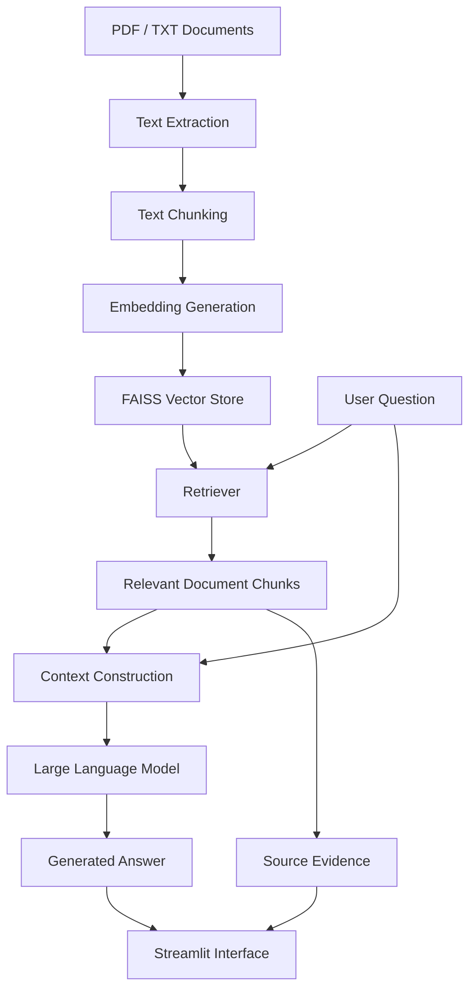

# Smart Document Assistant

**An AI-powered document intelligence application built with Retrieval-Augmented Generation (RAG).**

Smart Document Assistant enables users to upload documents, ask questions in natural language, and retrieve answers grounded in the content of those documents.

The project explores how document processing, semantic search, vector databases, and large language models can work together to make information more accessible and easier to verify.

## Overview

Searching through lengthy documents manually can be time-consuming. Traditional keyword searches may also miss relevant information when the wording of a query differs from the wording in the document.

Smart Document Assistant addresses this problem by combining semantic retrieval with language model generation. Instead of relying solely on an LLM's general knowledge, the application retrieves relevant document passages and uses them as context for answering questions.

## Key Features

- **Document Ingestion:** Upload PDF and TXT documents.
- **Multi-Document Question Answering:** Ask questions across uploaded documents.
- **Semantic Search:** Retrieve relevant passages using text embeddings.
- **Vector Similarity Search:** Use FAISS to search document embeddings.
- **Context-Grounded Responses:** Generate answers using retrieved document content.
- **Source Evidence:** Display available supporting document information.
- **Unknown-Answer Handling:** Handle questions when sufficient supporting information cannot be found.
- **Evidence Strength Indicator:** Provide an additional signal about the strength of retrieved evidence.

> The evidence strength indicator reflects retrieval or evidence strength. It should not be interpreted as a calibrated probability that an answer is correct.

## Architecture



## Technology Stack

| Technology | Role |
|---|---|
| Python | Core application logic |
| Streamlit | Interactive user interface |
| LangChain | LLM integration and RAG components |
| Hugging Face | Language model inference |
| Sentence Transformers | Semantic embedding generation |
| FAISS | Vector similarity search |
| PyPDF | PDF text extraction |
| NumPy | Numerical processing |
| python-dotenv | Environment configuration |

## How It Works

### 1. Document Processing

Users upload PDF or TXT files. The application extracts the available text and divides it into smaller chunks suitable for retrieval.

### 2. Embedding Generation

Each text chunk is converted into a numerical vector representation using a sentence embedding model. These embeddings capture semantic information that supports similarity-based search.

### 3. Vector Indexing

The generated embeddings are stored in a FAISS index, enabling the application to retrieve document passages that are semantically relevant to a user's question.

### 4. Context Retrieval

When a question is submitted, the retriever searches the vector index and selects relevant passages from the uploaded documents.

### 5. Answer Generation

The retrieved passages and the user's question are passed to the configured language model. The model generates a response using the available document context.

### 6. Evidence Presentation

The application displays the generated answer alongside available source or evidence information to help users inspect the supporting content.

## Getting Started

### Prerequisites

- Python 3.9 or later
- pip
- A Hugging Face API token compatible with the configured inference service

### Installation

**1. Clone the repository**

```bash
git clone https://github.com/Dhanush7753/Smart-Document-assistant.git
cd Smart-Document-assistant
```

**2. Create a virtual environment**

```bash
python -m venv venv
```

Activate it on Windows:

```powershell
.\venv\Scripts\Activate.ps1
```

On macOS or Linux:

```bash
source venv/bin/activate
```

**3. Install dependencies**

The current repository uses `requirement.txt`.

```bash
pip install -r requirement.txt
```

**4. Configure environment variables**

Create a `.env` file in the project root:

```env
HUGGINGFACEHUB_API_TOKEN=your_huggingface_token
```

Use your own token and keep it private. Never commit credentials to version control.

**5. Launch the application**

```bash
streamlit run app.py
```

Open the local URL displayed in your terminal, typically:

`http://localhost:8501`

## Usage

1. Start the application.
2. Upload one or more PDF or TXT documents.
3. Allow the application to process the uploaded content.
4. Enter a question related to the documents.
5. Review the generated answer and available supporting evidence.
6. Test questions whose answers are absent from the uploaded documents.

## Design Considerations

### Grounding Answers in Retrieved Context

Retrieval-Augmented Generation provides the language model with relevant passages from the document collection before answer generation. This can reduce reliance on unsupported general knowledge, although it does not guarantee correctness.

### Separating Retrieval from Generation

The retrieval stage determines which document passages are relevant, while the generation stage uses those passages to formulate an answer. Keeping these stages conceptually separate makes it easier to investigate retrieval failures and answer-generation errors.

### Evidence Strength versus Answer Correctness

A strong retrieval result does not necessarily mean that the generated answer is correct. Retrieval quality, context completeness, source relevance, and model behavior must be evaluated independently.

## Current Limitations

- Supported document formats are PDF and TXT.
- Complex layouts and tables may not be extracted reliably.
- Retrieval quality depends on document structure, chunking, and embedding quality.
- Language model inference depends on the configured external service.
- The evidence strength indicator is not a calibrated confidence score.
- The current architecture is designed as a lightweight application rather than a fully production-hardened system.
- Retrieval and answer quality require more systematic evaluation.

## Potential Improvements

The following are opportunities for future development, not claims about existing functionality.

- **Advanced Retrieval:** Experiment with hybrid keyword and semantic search.
- **Reranking:** Reorder retrieved passages using a dedicated reranking model.
- **RAG Evaluation:** Build a test dataset and measure retrieval relevance, answer faithfulness, and citation accuracy.
- **Improved Citations:** Trace generated claims to precise source passages and page numbers.
- **Persistent Collections:** Preserve document indexes across application sessions.
- **Document Intelligence:** Explore document summarization and comparison.
- **Broader Format Support:** Add DOCX, CSV, and Excel processing.
- **Conversation Context:** Support reliable follow-up questions across multiple turns.
- **Production Readiness:** Add authentication, access controls, automated tests, logging, and deployment workflows.

## Repository Structure

```text
Smart-Document-assistant/
├── app.py
├── config/
│   └── settings.py
├── src/
│   ├── chatbot.py
│   ├── document_processor.py
│   ├── embeddings.py
│   ├── retriever.py
│   ├── utils.py
│   └── vector_store.py
├── tests/
├── docs/
├── screenshots/
├── requirement.txt
├── test_chatbot.py
├── upload_docs.py
├── .gitignore
└── readme.md
```

## Security Considerations

- Store API credentials outside source code.
- Exclude `.env` files, local environments, caches, and unnecessary generated artifacts from version control.
- Do not publish confidential documents or personal information.
- Treat uploaded documents as untrusted input.
- Review access controls and document isolation before deploying the application for multiple users.

## Project Focus

This project explores practical implementation of:

- Generative AI and Retrieval-Augmented Generation
- Semantic embeddings and vector search
- Document processing and retrieval pipelines
- LLM integration and context construction
- Evidence-grounded question answering
- Hallucination reduction and evaluation challenges


**Repository:** [Smart Document Assistant](https://github.com/Dhanush7753/Smart-Document-assistant)
