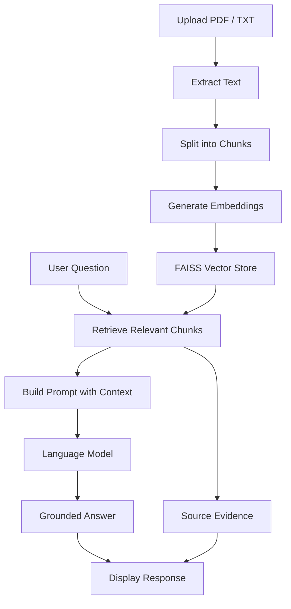

# Smart Document Assistant

An AI-powered document question-answering application built using **Retrieval-Augmented Generation (RAG)**. Upload PDF or TXT documents, ask questions in natural language, and receive answers grounded in retrieved document content.

## Features

- Upload PDF and TXT documents
- Support multiple documents
- Automatic text extraction and chunking
- Semantic embeddings using Sentence Transformers
- FAISS-based vector similarity search
- Retrieval-Augmented Generation (RAG)
- Natural-language question answering
- Source and evidence information for retrieved content
- Unknown-answer handling for questions lacking sufficient evidence
- Evidence/retrieval-strength indicator

> **Note:** The evidence indicator represents retrieval strength, not a calibrated probability that an answer is correct.

## Architecture



## Technology Stack

| Technology | Purpose |
|---|---|
| Python | Core application logic |
| Streamlit | User interface |
| LangChain | RAG pipeline and LLM integration |
| Hugging Face | Language model inference |
| Sentence Transformers | Text embedding generation |
| FAISS | Vector similarity search |
| PyPDF | PDF text extraction |
| NumPy | Numerical processing |
| python-dotenv | Environment configuration |

## Project Structure

```text
smart-document-assistant/
├── app.py
├── config/
│   └── settings.py
├── src/
│   ├── chatbot.py
│   ├── document_processor.py
│   ├── embeddings.py
│   ├── retriever.py
│   ├── utils.py
│   └── vector_store.py
├── tests/
├── docs/
├── screenshots/
├── requirement.txt
├── test_chatbot.py
├── upload_docs.py
├── .gitignore
└── README.md
```

## Installation and Setup

### Prerequisites

- Python 3.9 or later
- pip
- Hugging Face API access for the configured inference service

### 1. Clone the Repository

Replace the placeholder with your actual GitHub repository URL.

```bash
git clone <your-repository-url>
cd smart-document-assistant
```

### 2. Create a Virtual Environment

```bash
python -m venv venv
```

Activate the environment on Windows PowerShell:

```powershell
.\venv\Scripts\Activate.ps1
```

### 3. Install Dependencies

```bash
pip install -r requirement.txt
```

### 4. Configure Environment Variables

Create a `.env` file in the project root:

```env
HUGGINGFACEHUB_API_TOKEN=your_huggingface_token
```

Replace the placeholder with your own token. Keep your API credentials private and never commit them to GitHub.

### 5. Run the Application

```bash
streamlit run app.py
```

Open the local URL displayed in your terminal, typically:

`http://localhost:8501`

## How to Use

1. Launch the Streamlit application.
2. Upload one or more PDF or TXT documents.
3. Allow the application to process the documents.
4. Ask a question about the uploaded content.
5. Review the generated answer and available source information.
6. Try an unanswerable question to examine the application's unknown-answer handling.

## How It Works

The application follows a Retrieval-Augmented Generation workflow:

1. **Document ingestion:** Read uploaded PDF and TXT files.
2. **Text extraction:** Extract textual content from documents.
3. **Chunking:** Split the extracted text into smaller passages.
4. **Embedding generation:** Convert passages into vector representations.
5. **Vector storage:** Store the embeddings in FAISS.
6. **Retrieval:** Search for passages relevant to the user's question.
7. **Generation:** Supply the retrieved context and question to the language model.
8. **Evidence display:** Present the answer with available supporting source information.

## Hallucination Reduction

The application aims to reduce unsupported answers by retrieving relevant document passages before generating a response.

Its approach includes:

- Retrieving relevant document chunks
- Providing retrieved context to the language model
- Encouraging answers grounded in the supplied context
- Displaying available source information
- Handling questions when sufficient evidence cannot be found

RAG does not eliminate hallucinations entirely. Retrieval errors, incomplete documents, and incorrect model-generated answers remain possible.

## Testing

The project documentation describes testing with:

- Questions whose answers appear in uploaded documents
- Questions whose answers are absent from uploaded documents
- Multiple uploaded documents

A comprehensive evaluation should additionally measure retrieval quality, citation correctness, answer faithfulness, and performance on a fixed test set.

## Current Limitations

- PDF and TXT are the supported document formats.
- Complex PDF layouts and tables may not be extracted accurately.
- Answer quality depends on document quality and retrieval relevance.
- Large document collections may require optimization.
- The evidence indicator is not a calibrated measure of answer correctness.
- Language model inference depends on the configured external service.
- The current FAISS-based approach is intended for a lightweight application rather than large-scale production deployment.

## Future Improvements

Potential improvements include:

- Hybrid keyword and semantic retrieval
- Reranking retrieved passages
- Improved chunking strategies
- Automated RAG evaluation
- More reliable source citations
- Persistent document collections
- Document summarization and comparison
- DOCX, CSV, and Excel support
- Conversation memory across sessions
- Authentication and access controls
- Automated testing and production deployment

## Security

- Store API credentials in environment variables.
- Exclude `.env` files, virtual environments, cache files, logs, and unnecessary generated files from version control.
- Never commit passwords, tokens, or other secrets.
- Review document handling and access controls before deploying the application for multiple users.

## Learning Objectives

This project provides practical experience with:

- Generative AI and Retrieval-Augmented Generation
- Text embeddings and vector similarity search
- Document processing and chunking
- LLM integration and prompt construction
- Context-grounded question answering
- Evidence-based evaluation and hallucination reduction

## License

No license is specified here. Add an appropriate open-source license if you intend to permit others to reuse, modify, or distribute this project.

---

**Smart Document Assistant** — exploring document intelligence through Retrieval-Augmented Generation.
